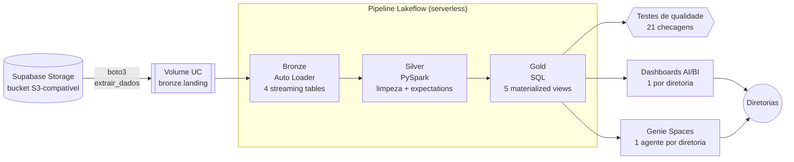

# E-commerce Lakehouse

Plataforma de dados de um e-commerce brasileiro construída no Databricks, da extração na
origem até o consumo pela diretoria: ingestão incremental, arquitetura medalhão, testes de
qualidade, governança no Unity Catalog, dashboards por diretoria e um agente de IA (Genie)
para cada diretor perguntar em português. Tudo como código, em dois ambientes isolados.


## O problema de negócio

Três diretorias olhando para os mesmos dados de venda (13/12/2025 a 11/01/2026), cada uma
com uma pergunta diferente:

| Diretoria | Pergunta | Resposta encontrada |
|---|---|---|
| **Comercial** | Quanto vendemos, quando, em qual canal e com quais produtos? | R$ 974.077,28 em 3.020 vendas, ticket médio de R$ 322,54. E-commerce é 72% da receita. Sexta tem a pior receita média por dia. |
| **Customer Success** | Quem são os melhores clientes e onde estão? | 10 clientes VIP (de 50) geram 27% da receita. Norte é a região que mais compra (R$ 333 mil). |
| **Pricing** | Estamos mais caros que a concorrência, e onde agir? | 35 produtos acima de todos os concorrentes, mas só 20 são confirmados (R$ 161 mil de receita). Os outros 15 são preço suspeito de coleta e não devem gerar ação. |

O caso de Pricing mostra por que a modelagem importa: um dashboard ingênuo mandaria baixar o
preço de 35 produtos. O modelo separa preço confirmado de preço suspeito (erro de coleta ou
promoção relâmpago), e a recomendação cai para 20.

## Arquitetura



Um único job orquestra `extrair_dados` → `atualizar_pipeline` → `testes_qualidade`. Se algum
teste falhar, o job falha antes de qualquer pessoa ver um número errado.

| Camada | O que faz | Exemplos de regra |
|---|---|---|
| **Bronze** | Ingestão incremental dos arquivos via Auto Loader, sem nenhuma limpeza. Guarda `_arquivo_origem` e `_data_ingestao` para rastreabilidade. | — |
| **Silver** | Deduplica, tipa e padroniza. Problema conhecido é marcado em coluna, nunca descartado (apagar venda mudaria a receita). | Nome sem pronome de tratamento; UF → região IBGE; venda de produto não cadastrado sinalizada; preço de concorrente abaixo de 60% do nosso marcado como suspeito |
| **Gold** | Uma tabela por pergunta de negócio, com todas as colunas comentadas (unidade e regra de cálculo), o que alimenta dashboard e Genie. | Segmentação VIP/TOP_TIER/REGULAR; ranking de produtos; classificação de preço em 5 faixas |

## Decisões técnicas

Algumas escolhas que não eram óbvias e o motivo de cada uma:

- **Extração em Python em vez de External Location.** O Unity Catalog só governa storage
  externo de AWS S3, Azure, GCS e Cloudflare R2. Um endpoint S3-compatível como o Supabase
  fica de fora, então a extração usa boto3 e pousa os arquivos num Volume; dali em diante
  tudo é governado. Credenciais só via secret scope.
- **Landing zone com uma pasta por tabela.** Separa *buscar o dado* de *ingerir o dado*: se a
  ingestão falha, não é preciso chamar a origem de novo, e cada stream do Auto Loader tem um
  schema e um checkpoint próprios.
- **Bronze em streaming, silver e gold em batch.** A bronze acumula arquivos incrementalmente;
  silver e gold são materialized views recalculadas a cada run, o que mantém a deduplicação
  simples e correta.
- **Regra de negócio defendida em todos os lugares.** Ticket médio é sempre receita ÷ vendas,
  nunca média de médias; dia da semana se compara pela receita média por dia (o período tem
  5 sábados e só 4 terças); `clientes_unicos` nunca é somado entre linhas. As mesmas regras
  estão nos comentários das colunas, nos dashboards e nas instruções do Genie.
- **Um catálogo por ambiente.** `ecommerce_lakehouse_dev` e `ecommerce_lakehouse` têm os mesmos
  schemas e tabelas; o código nunca fixa catálogo. Diretorias, dashboards publicados e Genie
  só enxergam prod.
- **Governança testada, não só declarada.** Uma identidade da diretoria de CS lê a própria
  tabela e é bloqueada em três níveis: gold de outra diretoria, silver e catálogo de dev.
- **Agentes avaliados como código.** Cada Genie Space tem benchmarks com a resposta esperada.
  A primeira avaliação pegou erros reais do agente (percentual VIP calculado como 100%,
  contagem que excluía produtos suspeitos); instruções e exemplos foram corrigidos até 18/18.

## Resultados

- **Qualidade:** 15 regras que barram o pipeline (`expect_all_or_fail`), 3 alertas medidos
  (`expect`), 2 constraints na gold e 21 testes no notebook final (chaves únicas, receita
  batendo entre camadas, toda coluna gold comentada…).
- **Problemas de dado encontrados e tratados:** 20 vendas de produto não cadastrado
  (R$ 4.240,01), 5 vendas anteriores ao cadastro do produto, 55 preços de concorrente
  suspeitos e 11 clientes cadastrados com pronome de tratamento no nome.
- **Consumo:** 3 dashboards e 3 agentes Genie em produção, cada um acessível só pela
  diretoria dona do domínio.
- **Rastreabilidade:** lineage bronze → silver → gold capturado automaticamente pelo Unity
  Catalog; auditoria de acesso via `system.access.audit`.

## Stack

Databricks (Lakeflow Declarative Pipelines, Auto Loader, Jobs, AI/BI Dashboards, Genie,
Unity Catalog), Declarative Automation Bundles, PySpark, SQL, Supabase Storage, GitHub
Actions.

## Estrutura

```
ecommerce_lakehouse/
├── databricks.yml              # bundle: targets dev e prod, um catálogo por ambiente
├── extracao/                   # Supabase -> Volume de landing (boto3)
├── src/
│   ├── ecommerce_lakehouse_etl/transformations/
│   │   ├── bronze/             # Auto Loader (Python)
│   │   ├── silver/             # limpeza e expectations (Python)
│   │   └── gold/               # tabelas de negócio (SQL)
│   ├── dashboards/             # 3 dashboards AI/BI
│   └── genie/                  # 3 Genie Spaces
├── resources/                  # pipeline, jobs, dashboards e Genie como recursos do bundle
├── governance/                 # bootstrap do Unity Catalog e grants por papel
├── testes/                     # testes de qualidade (última task do job)
├── seed/                       # arquivos de origem para reproduzir o projeto
└── AGENTS.md                   # convenções e regras de negócio do projeto
```

## Como reproduzir

Setup completo, comandos por ambiente e consultas de auditoria estão em
[`ecommerce_lakehouse/README.md`](ecommerce_lakehouse/README.md). Em resumo:

1. Suba os arquivos de `ecommerce_lakehouse/seed/` num bucket S3-compatível e crie o secret
   scope com as credenciais.
2. `databricks bundle deploy -t dev` e `databricks bundle run setup_ambiente -t dev`.
3. `databricks bundle run ecommerce_lakehouse_job -t dev`.
